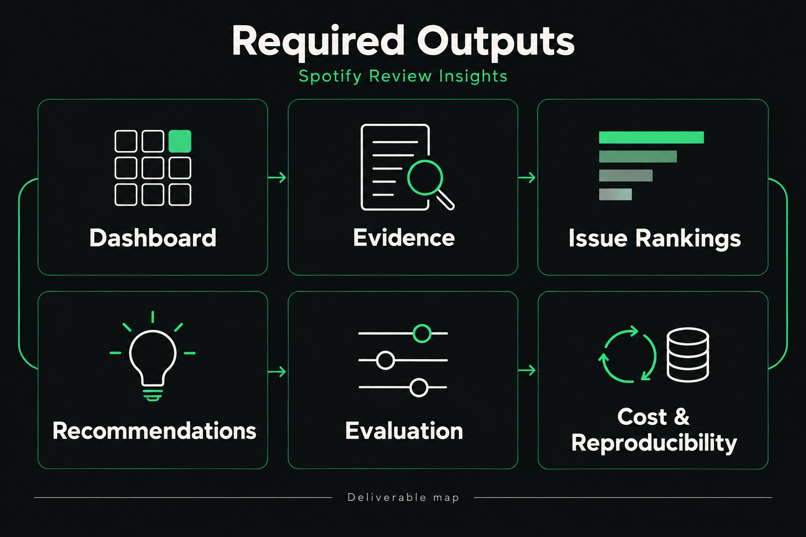

# Fundamentals of Agentic AI Final Capstone Project


**Spotify Review Insights**

This project turns saved Spotify Google Play reviews into an evidence-linked product priority assessment. The assignment scope is **at least 100,000 original source reviews**. The selected run accounts for 110,000 original IDs; 100,229 have structurally accepted labels and evidence. Structural acceptance checks identity, format, and source support. It is not a human accuracy score.

**Deadline:** 13 October 2026, 11:59 pm Pacific Time. **Submission:** public GitHub URL through bCourses, pending.

**Public code repository:** [Fundamentals of Agentic AI Final Assignment](https://github.com/patronofalltrades/Fundamentals-of-Agentic-AI-Final-Assignment). This feature branch is the integration candidate.

## Agent handoff — 13 October 2026 UTC

Verified on `feat/grouping-v4-integration`: code reconciliation `628caef`, image integration `504d064`, and release record `1a2ee6e` were pushed to the explicit GitHub feature branch. No remote main merge or course submission occurred. The reconciled code passed **408 Python tests**, CLI help, the offline cost calculator, and the web privacy test. Image links, hashes, and staged diffs passed checks.

- **Production:** deployment `dpl_5ZGRgcJrvoaXxQRwzjtmeTQPUkoN` is live at the canonical URL below. It contains main `00ad910` plus only the reviewed evaluation attribution component. The build passed; canonical API checks still show **110,000 selected / 100,229 accepted**. The corrected bundle includes the isolated-evaluator attribution and diagnostic limits.
- **Golden evaluation — live:** all **50/50** source-only predictions are frozen, scored, and imported: topic **26/50**, intent **38/50**, severity **30/50**, joint **14/50**; severity MAE **0.56**, zero missing predictions, `official=false`. The historical **9/50** result belongs to a separate selected-production-run diagnostic. Both canonical aggregate APIs and Chrome confirm the saved score, isolated-evaluator attribution, and diagnostic limits. Twelve human cases request review, eight source texts overlap development data, and earlier golden influence is unknown.
- **Import completed:** the user supplied the existing connection through the private local flow. Its file permissions were 0600, and the database matched both the saved and live release identities, 110,000 selected rows, 100,229 classifications, and the classifier configuration. The authorized transaction saved only `dashboard_meta.evaluation:original`; other metadata and checked table counts were unchanged. No import blocker remains. The adapter and evaluation tests passed **13 focused tests** on 13 October. Credentials and private import receipts remain ignored and were not published.
- **Cost owner — Claude:** his main-branch cost artifacts were preserved. See the [cost guide](cost/README.md), [pilot report](reports/cost100-pilot.md), [dated rates](cost/pilot/rates.json), [measured JSON report](cost/pilot/report.json), and [offline calculator](tools/cost100_offline_calculator.py). No paid inference was added in this closeout.
- **Images and demo:** the five README images are committed; see [asset provenance](docs/assets/README.md). The private Library file `synthetic-interruption-resume-demo.mp4` records an actual offline SIGINT, disk resume, and zero repeated label requests. Its local path is `local/resume_demo_synthetic_20261013/synthetic-interruption-resume-demo.mp4`. It uses synthetic data and mock responses, with zero outbound calls; it does not replace missing historical main-run checkpoints.
- **Grading:** the unchanged checker remains **`review_required`**, with no automatic grade. The 660,622-source contract versus 110,000-selected scope and historical provenance/checkpoint gaps remain disclosed. The accepted-evidence count does not clear those flags.

The [final release handoff](reports/final-release-handoff-2026-10-12.md) records exact files, deployment evidence, video hash, and remaining limits. Continue from this dated status; earlier reports retain their historical observations.

## Live dashboard

[Open the read-only dashboard](https://hanif-spotify-insights.vercel.app). No login is required. It shows the **100,000-review results**: 110,000 selected source IDs, 100,229 structurally accepted rows, the provisional ranking and memo. The public site serves a sanitized database copy. Opening the page does not run a model. Hanif reported 20 passing browser checks for this release; the checks were not rerun in this branch.

### Production screenshots

Captured from the live site on 12 October 2026 at 23:32–23:33 UTC. This is an independent course project and is not affiliated with Spotify. [Capture manifest and hashes](docs/assets/production-2026-10-12/MANIFEST.md).


The live overview shows 110,000 selected source reviews, 100,229 classified reviews, and 30,400 complaint or cancellation candidates.

<details>
<summary>Public issue ranking and prompt benchmark</summary>


The public ranking excludes 23 flagged candidates. It shows 5,195 ad-related complaints and severity sum 11,869; the course baseline below includes flagged records and has 5,197 and 11,874. Playback has 2,474 in both. The ranking remains advisory after 40% agreement with the blind human review. The golden card was still pending when this image was captured.


This is the 100-review **prompt comparison**, not the golden-50 human evaluation: 32 topic changes, zero intent changes, one severity change, and 16 review-flag changes. These dated captures predate the successful golden-score import on 13 October; the live evaluation card now shows the saved score.

</details>

## Current result

| Stage | Verified status |
| --- | --- |
| Source and evidence | 110,000 selected original IDs; 100,229 structurally accepted and 9,771 nonaccepted. The source ID and hash mapping remains private. [Extraction report](reports/accepted-100k-completion.md). |
| Issue catalog and grouping | Frozen 41-issue catalog. Corrected membership has 30,400 distinct complaint/cancellation candidates, one issue each. [Grouping handoff](reports/grouping-v4-handoff.md). |
| Ranking | Deterministic `severity_sum`, descending, then issue ID ascending. The public projection excludes 23 known flagged candidates and ranks 30,377. The top baseline issue is `USE-ADS` with 5,197 mapped records and severity sum 11,874. This ranking is **advisory**. |
| Product memo | [Provisional memo](reports/provisional-product-priority-memo.md) recommends targeted human review of the leading issue before a product change. Its 164 claim references match saved numbers. Numeric consistency does not establish that the map or recommendation is correct. |
| Human quality check | Before human overrides, grouping agreed with the blind human review on **16/40 (40.0%)**. The 40 cases are no longer untouched holdouts in final membership. Separate model-verifier agreement was 511/600 (85.2%); this is not human accuracy. |
| Dashboard release | The 100,000-review results are live with a provisional memo, a dedicated memo page, and one clearly provisional `USE-ADS` recommendation. A private imported database and sanitized public copy were checked locally. The public-copy audit compared 144 API routes with zero differences and found no review IDs, source hashes, long quotes, or exact quotes. |
| Cold/warm cost pilot | A separate 100-review pilot attempted 100, accepted 98, and quarantined two exact-quote failures. Its 112 metered calls charged $0.007410287. Cold active stages took 588.435 seconds; saved warm replay took 0.008029 seconds with zero outbound calls. A later read-only validation took 0.019757 seconds. Pilot checkpoints are separate from the historical main run. [Pilot report](reports/cost100-partial-checkpoint.md). |

The memo proposes a cautious next action. The historical reviews do not establish observed churn, revenue, or causal impact.



Generated illustration of the requested deliverables. The table above and evaluation limits below record their actual status; the graphic is not a completion certificate. [Asset provenance](docs/assets/README.md).

## Run locally

Use Python 3.9 or newer and the standard library. Run commands from the repository root. The CLI operates offline and requires no credential:

```sh
python3 -m spotify_pipeline --help
PYTHONDONTWRITEBYTECODE=1 python3 -m unittest discover -s tests -t . -q
```

The offline pipeline commands are `ingest`, `status`, `checkpoint`, and `cost`; see [implementation notes](docs/implementation.md). They accept arbitrary contract-shaped input CSV paths. The selected large run used bounded saved batches and is documented in the [completion report](reports/accepted-100k-completion.md). Saved ranking and claims can be replayed without a model call. The frozen catalog is [issue-catalog-v1.json](docs/issue-catalog-v1.json).

Private results are in ignored, mode-0600 `local/`. The corrected grading folder is `local/grading_v4_final/`; the later `local/grading_v4_submission_candidate/` adds authentic call and ingestion exports plus a separately named copy of the cold/warm pilot. It includes 110,000 selected records and seven declared human label corrections. The [mission-critical handoff](reports/submission-critical-handoff-2026-10-12.md) gives paths, hashes, checker results, and missing historical artifacts. The [public cost deliverable](cost/README.md) has redacted calls, editable dated rates, checkpoints, and an offline calculator; the [private-file calculator notes](cost/README.actual-pilot.md) describe the original pilot. The older `cost/measurements.json` and `cost/rates.json` remain null scaffolds. **Do not publish either private grading folder or the private database.**

The dashboard application is included in this branch. Its read-only HTTP backend queries a saved SQLite or Postgres database. `/api/summary`, `/api/issues`, `/api/claims`, `/api/memo`, `/api/recommendations`, and `/api/reviews` retrieve stored results. From the repository root, `python3 -m dashboard serve --db local/dashboard_public_v4_release.db` serves the prepared local sanitized copy at `http://127.0.0.1:8765`; it makes no model call. See the [dashboard guide](docs/dashboard.md) for private import, public export, API behavior, and web build instructions.

## Evaluation and limits

The 50 human golden labels remain in an isolated private file. All **50 source-only predictions were frozen before scoring**. The isolated evaluator measured 52% topic agreement, 76% intent agreement, 28% exact topic–intent–severity agreement, **30/50 exact severity agreement**, severity mean absolute error 0.56, and sentiment mean absolute error 0.21. Twelve human cases are marked `needs_review`; eight source texts overlap development data. A private aggregate report records topic support, confusion counts, and severity-error distribution without case-level answers. These diagnostics do not establish population accuracy. Any golden-influenced revision needs a fresh untouched holdout; freezing this file before scoring cannot rule out earlier golden influence. See the [aggregate evaluation and cost handoff](reports/golden-gap-and-checker-2026-10-12.md). The independent grouping verifier is a separate model, and the 40-case blind human comparison remains the strongest grouping warning. No untouched grouping holdout remains after 91 human overrides. The public projection excludes known flagged complaint/cancellation records; 47 flagged accepted records are excluded from examples. Public excerpts are screened to at most 30 words and use opaque references.

The original course checker still describes a larger scope. The original 660,622-row CSV was downloaded in place through macOS iCloud and verified against its pinned SHA-256. The **unchanged checker** ran against its independently generated full-source reference and the private 110,000-selected-row candidate; it returned **`review_required`, not a pass**. It validated 100,229 completed-record schemas, issue membership, baseline ranking, and numeric claims, but reported 550,622 records missing under its unchanged full-corpus denominator. Other flags are 7,980 nonaccepted statuses, 949 partial/uncertain call outcomes, 79,797 unknown run phases, 94 unavailable usage fields, 20,938 split/indirect cache-provenance cases, missing verifier/group/memo call records, absent main-run checkpoints, and missing resume proof. Every checker flag and its disposition is listed in the [prepublication audit](reports/prepublication-reconciliation-2026-10-12.md). The instructor permits the 100,000-review scope; the discrepancy is disclosed without changing the checker. The private submission candidate includes the exact full-source ingestion profile and 79,797 authentic main-run call records. Grouping provider per-call token and dollar usage remains **unknown**, not zero. The separate cold/warm 100-review pilot is measured, with 98 accepted, two quote quarantines, and $0.007410287 recorded charge; its authentic checkpoints do not replace missing main-run checkpoints. Offline rate sensitivity is verified; a full-run projection remains unavailable without stage-specific scaling assumptions, and local compute cost is unknown. See the [mission-critical handoff](reports/submission-critical-handoff-2026-10-12.md).

## Data boundary

Keep original review IDs, raw text, source hashes, exact quotes, human answer files, private databases, and unsanitized exports outside Git. Saved public examples use opaque IDs with a private mapping. Nonaccepted states are public only as sanitized aggregates. The frozen issue catalog and human corrections are versioned; changing them requires a new review. No paid call or model run is required to inspect saved outputs.
