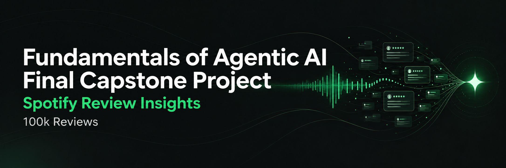
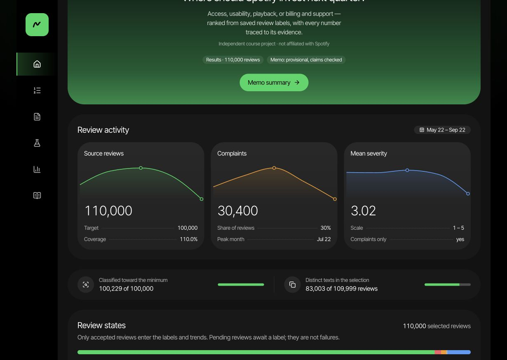
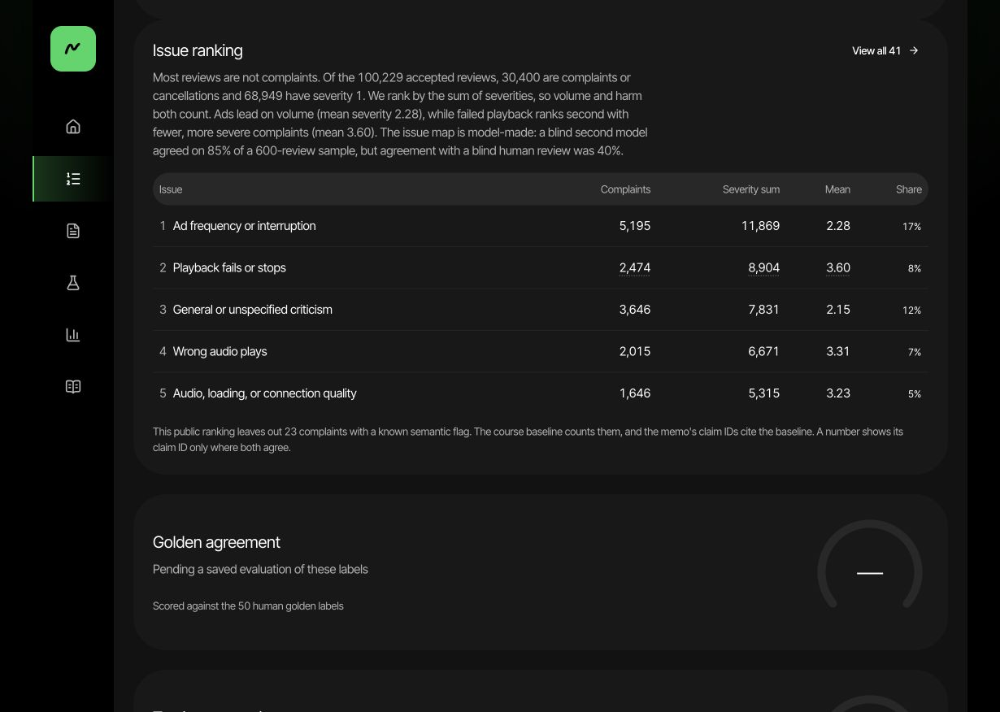
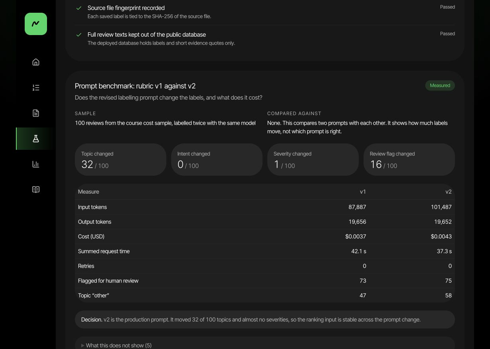

# Fundamentals of Agentic AI Final Capstone Project



**Spotify Review Insights.** A multi-agent pipeline reads public Google Play reviews of Spotify. It labels each
review, groups complaints into product issues, ranks the issues, and writes a short decision memo. Every number in
the memo traces back to saved records.

- **Product question:** which Spotify problems should get product effort first?
- **Answer (provisional):** ad interruptions (`USE-ADS`) lead the ranking. The memo recommends a targeted human
  review of that issue before a product change, because the issue map is model-made.

| Item | Value |
| --- | --- |
| **Live dashboard** | **https://hanif-spotify-insights.vercel.app**: public and read-only, with no login. The full memo is at [`/memo/`](https://hanif-spotify-insights.vercel.app/memo/). |
| Repository | [patronofalltrades/Fundamentals-of-Agentic-AI-Final-Assignment](https://github.com/patronofalltrades/Fundamentals-of-Agentic-AI-Final-Assignment) |
| Scope | 110,000 selected source reviews. 100,229 have structurally accepted labels and evidence. The instructor set a minimum of 100,000. |
| Deadline | 13 October 2026, 23:59 Pacific Time. Submission: the public GitHub URL through bCourses (pending). |
| Spend | About US$4.2 measured for the main run (Jev US$2.92, DeepInfra US$1.29). The cap is strictly below US$50. |
| **Grading folder** | [Release `grading-2026-10-13`](https://github.com/patronofalltrades/Fundamentals-of-Agentic-AI-Final-Assignment/releases/tag/grading-2026-10-13): `grading-110k.zip` and the interruption-and-resume video |
| Requirement check | [Benchmark against the course requirements](reports/rubric-benchmark-2026-10-13.md) (13 October) |

"Structurally accepted" means that code checked the review's identity, format and exact-quote support. It is not
a human accuracy score.

## Where each deliverable is

| Course requirement | Where | Status |
| --- | --- | --- |
| Pipeline program with distinct agent roles | `spotify_pipeline/`, `tools/`; [architecture](docs/architecture.md) | Done. See disclosure 2 for the grouping step. |
| 100,000-review run | [Completion report](reports/accepted-100k-completion.md) | Done, 9 October |
| Issue catalog, grouping and baseline ranking | [Frozen catalog](docs/issue-catalog-v1.json), [grouping handoff](reports/grouping-v4-handoff.md) | Done. The ranking is advisory. |
| Decision memo with checked claims | [Provisional memo](reports/provisional-product-priority-memo.md), live at [`/memo/`](https://hanif-spotify-insights.vercel.app/memo/) | Done. All 164 claims match the saved numbers. |
| Grading folder and `check_submission.py` | [Release `grading-2026-10-13`](https://github.com/patronofalltrades/Fundamentals-of-Agentic-AI-Final-Assignment/releases/tag/grading-2026-10-13); [checker flags and dispositions](reports/prepublication-reconciliation-2026-10-12.md) | Published. The checker returns `review_required`. |
| 100-review cost and runtime calculator (`cost/`) | [cost/README.md](cost/README.md), [pilot report](reports/cost100-pilot.md) | Measured cold and warm runs, pilot IDs, and full-run estimates. |
| Interruption and resume | Cost pilot checkpoints in [`cost/pilot/`](cost/pilot/); demo video in the [release](https://github.com/patronofalltrades/Fundamentals-of-Agentic-AI-Final-Assignment/releases/tag/grading-2026-10-13) | Pilot shown. No main-run checkpoints. |
| Human golden evaluation | [Golden evaluation and checker report](reports/golden-gap-and-checker-2026-10-12.md) | Done; live on the dashboard |
| Dashboard, backend, database, live URL | [Live site](https://hanif-spotify-insights.vercel.app), [dashboard guide](docs/dashboard.md) | Done |

## Results

| Stage | Result |
| --- | --- |
| Source accounting | 110,000 selected original IDs: 100,229 accepted, 1,791 quarantined, 1,457 uncertain or blocked, 6,522 pending, 1 empty text. |
| Labels | Jev `jev-1.13.0` gave each review a topic, intent and severity, 10 reviews per request. Rubric frozen as [`jev-rubric-v2`](docs/topic_rubric_v2.md). DeepInfra `openai/gpt-oss-120b` saved an exact quote as evidence, and code checked each quote against the source text. |
| Issue map | 30,400 complaint and cancellation records, one issue each, across 41 catalog issues. Human decisions replace the model in 91 cases, and 7 label corrections are declared. |
| Ranking | `priority_score = severity_sum`, descending, then issue ID ascending. Top baseline issue: `USE-ADS`, 5,197 records, severity sum 11,874. The public view leaves out 23 flagged records (5,195 and 11,869). Second: `PLY-FAIL`, 2,474 records. |
| Quality checks | A blind model verifier agreed on 511 of 600 records (85.2%). A blind human review agreed on 16 of 40 (40.0%), before overrides. |
| Golden 50 | Exact agreement with human labels: topic 26/50, intent 38/50, severity 30/50, all three 14/50. Severity MAE 0.56; zero missing predictions. |
| Cost pilot (`cost_100.csv`) | 112 metered calls, US$0.007410287, 98 accepted, 2 quarantined. Cold active time 588.4 s; warm replay 0.008 s with zero new calls. |

### Production screenshots

Captured from the live site on 12 October 2026 at 23:32–23:33 UTC. This is an independent course project and is
not affiliated with Spotify. [Capture manifest and hashes](docs/assets/production-2026-10-12/MANIFEST.md).



<details>
<summary>Public issue ranking and prompt benchmark</summary>



The public ranking leaves out 23 flagged candidates. The golden card was still pending when this image was
captured; the live card now shows the saved score.



This is the 100-review prompt comparison, not the golden-50 evaluation.

</details>

## How it works

| Stage | Done by | Saved output |
| --- | --- | --- |
| Ingest | Code: parse the CSV, keep every ID and source hash, find exact duplicate texts | Canonical SQLite database; [ingestion profile](reports/contract-ingestion.json) |
| Enrich | Jev (labels) and DeepInfra `gpt-oss-120b` (evidence quote), in batches with validated IDs | Per-batch results, call log, spend ledger |
| Verify | A separate blind model relabels a sample without seeing the first answer | Verifier sample and agreement |
| Group | Agents map each complaint to one issue in a frozen 41-issue catalog | Issue membership |
| Rank | Code computes the baseline ranking | `ranking.csv` |
| Recommend | A model writes the memo from saved aggregates; code checks every claim ID | `claims.csv`, memo |

Code owns parsing, ID validation, hashing, caching, saved state, budget checks, ranking and claim checks. A shared
ledger reserves the worst-case cost before each call. No unknown outcome is retried automatically.

## Run and verify offline

Use Python 3.9 or newer. No installation, API key or model call is needed. Run from the repository root.

```sh
python3 -m unittest discover -s tests -t . -q        # 408 tests; 2 skip without private local files
python3 -m spotify_pipeline --help                   # ingest, status, checkpoint, cost
python3 -m tools.cost100_offline_calculator --scenario cost/scenario_full.json   # pilot and full-run estimate
```

Run the dashboard on your computer with a saved database:

```sh
python3 -m dashboard serve --db <dashboard.db>       # http://127.0.0.1:8765
```

The [dashboard guide](docs/dashboard.md) covers the private import, the public export and the web build. Paid
runs use separate tools in `tools/`. Each tool is offline by default and needs an explicit flag and approval to
make calls.

## Disclosures

1. **Scope.** The unchanged contract and checker expect all 660,622 IDs. This run covers 110,000 selected IDs,
   following the instructor's 100,000-review minimum. The checker reports 550,622 missing IDs.
2. **Grouping step.** The 100k issue map was made by eight Claude Sonnet 5.5 subagents in Claude Code, with a
   blind Claude Opus 5.5 verifier. They ran from a chat session, not as a saved program stage. The cost pilot ran
   grouping as a program stage. Code removed possible names, handles and long numbers before the agents read the
   text; 1,500 records were mapped before this step was added. The agents saw no review IDs, human decisions or
   golden answers. Their per-call token usage was not recorded; it is unknown,
   not zero.
3. **Issue-map quality.** Blind human agreement was 40%. The ranking is advisory until a targeted human review.
4. **Checker result.** `check_submission.py` returns `review_required`. Besides the scope, it flags 7,980
   nonaccepted statuses, 949 partial or uncertain call outcomes, 79,797 unknown run phases, 94 unavailable usage
   fields, 20,938 rows with split cache or evidence provenance, missing historical verifier, group and memo call
   records, and missing main-run checkpoints. Each flag and its disposition is in the
   [prepublication audit](reports/prepublication-reconciliation-2026-10-12.md). No saved data was changed to hide
   a flag.
5. **Resume evidence.** The cost pilot shows interruption and resume (0 to 98 completed IDs, no completed ID sent
   again). The main run has no saved before and after checkpoints. The demo video uses synthetic data.
6. **Golden set.** Twelve human rows ask for review, eight texts overlap development data, and earlier golden
   influence cannot be ruled out. The scores are diagnostics, not population accuracy.
7. **Cost estimate.** The full-run cost is an estimate from the pilot's per-stage usage: US$35.11 (base, with
   exact-text reuse) to US$62.89 (conservative, without reuse). Elapsed time is modeled. Local compute cost is
   unknown.
8. **Data limits.** These are self-selected public reviews from a historical snapshot. They contain no revenue,
   plan tier or confirmed cancellations. A cancellation review states intent; it does not prove a cancellation.
   The memo makes no revenue or causal claim.

## Data boundary

- The public site serves an audited copy of the results. It reaches records only by random references, shows
  excerpts of at most 30 words, and leaves out possible personal information. All 144 public routes match the
  audited copy, with no review IDs, source hashes or full texts.
- Raw CSVs, original review IDs, exact quotes, human answer files, private databases and credentials stay out of
  Git, in ignored `local/` folders with mode 0600.
- Golden answers never enter model prompts, examples, caches or issue discovery.
- Source: [Kaggle dataset](https://www.kaggle.com/datasets/bwandowando/3-4-million-spotify-google-store-reviews)
  by BwandoWando, version 2, CC0. Full-file SHA-256
  `1fc85de68a304dd8978b537cfa58793d5f41cbaf417fa32cb53899f83a2fcef6`.

## Repository layout

| Path | Contents |
| --- | --- |
| `spotify_pipeline/` | Offline pipeline package: ingest, state, checkpoints, schema, cost replay, Jev adapter |
| `tools/` | Pilot and run tools, evidence, import, evaluation and the offline cost calculator |
| `dashboard/`, `web/`, `api/`, `vercel.json` | Read-only backend, web front end and the Vercel deployment |
| `cost/` | Cost pilot: records, calls, dated rates, report, checkpoints and the full-run scenario |
| `reports/` | Aggregate reports, with no review text, original IDs or private paths |
| `docs/` | Rubric, catalog, architecture, decisions and the [coordination record](docs/tasks.md) |
| `tests/` | Offline tests with synthetic fixtures |

## For agents working on this repository

Read [AGENTS.md](AGENTS.md) first. The release record is the
[final release handoff](reports/final-release-handoff-2026-10-12.md).

### Handoff to Alfred — 13 October

**State of `main`:**

- **Pipeline merged.** PR #22 (`6a3118f`) and PR #23 (`cec5be9`) merged the pipeline branch into `main`.
  Production serves that release from Neon database `dashboard_100k`; the rollback database is `dashboard_5000`.
- **Golden score live.** It is saved as `dashboard_meta.evaluation:original` in `dashboard_100k`.
- **Grading folder published.** It is the GitHub release `grading-2026-10-13` (`grading-110k.zip`). The ZIP holds
  the contract files from `local/grading_v4_submission_candidate/` and leaves out `cost100_pilot_separate/`,
  `pilot.db` and `free_verification_synthetic/`. Hanif approved publishing it, with its original review IDs and
  exact quotes. The release also holds `synthetic-interruption-resume-demo.mp4`.
- **`cost/` changed** (Claude):
  - `cost/pilot/` now holds the unredacted pilot files, with review IDs, as Hanif approved.
  - `tools/cost100_offline_calculator.py` gives full-run estimates from `cost/scenario_full.json`.
  - `cost/README.md` lists the pilot execution commands and the scaling decision.
- **Tests.** Two tests in `tests/test_golden_gap_runner.py` now skip when the private plan in `local/` is absent,
  so a fresh clone passes: 408 tests, OK.
- **Requirement check.** See the [benchmark](reports/rubric-benchmark-2026-10-13.md).

**Open items:**

1. Hanif submits the public GitHub URL through bCourses before 23:59 Pacific.
2. Optional: a recording of a real resume on saved state, in addition to the synthetic demo.
3. Keep every disclosure above. Do not change saved data to clear a checker flag.

**Rules:**

- No paid call, push or merge without Hanif's approval.
- Keep the total budget strictly below US$50.
- Do not publish the private database or `local/` files beyond what the release holds.
