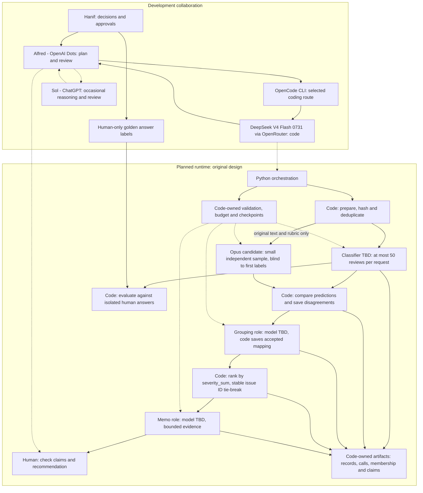

# Agent collaboration and planned runtime

The two groups have different jobs. Development agents help build and review
the code. The runtime part below is the original plan, written before the main
run. For what actually ran, see `docs/pipeline-extraction.mmd` and
`docs/pipeline-analysis.mmd` (also drawn on the dashboard's Pipeline section).

Hanif makes decisions and supplies the golden answers. Alfred is OpenAI Dots
and coordinates the plan and review. DeepSeek V4 Flash 0731 uses OpenRouter
through OpenCode CLI for future code work.
The two past coding passes used OpenCode Go; see `build_provenance.md`.
Sol is ChatGPT and can help with occasional reasoning. Coding runs through
OpenCode CLI.

What ran differs from this plan in four ways:

- Jev labelled one review per request, and DeepInfra `openai/gpt-oss-120b` extracted evidence for up to 25
  reviews per request.
- Grouping ran as a chat handoff: eight Claude Sonnet 5.5 agents and a blind Claude Opus 5.5 verifier on 600
  cases. Their saved inputs and outputs were recovered on 16 October; their usage was not recorded.
- On 16 October, `tools/gap_closure_eval.py` added a recorded grouping stage, a blind verifier at ten reviews per
  request, planted-error and prompt-injection tests, and a real interruption and resume, all with saved calls.
- Code owns the live controls: the shared ledger with worst-case reservations and holds
  (`spotify_pipeline/project_budget.py`), the durable queue and checkpoints, ID and exact-quote validation,
  ranking and claim checks.

Golden answers flow only to code evaluation. They never enter model inputs.
The project ceiling is US$49.99. Paid execution needs approval.

This is a GitHub Mermaid diagram. It describes responsibilities and planned
handoffs. It does not prove execution, automatic coordination, or shared locks.
